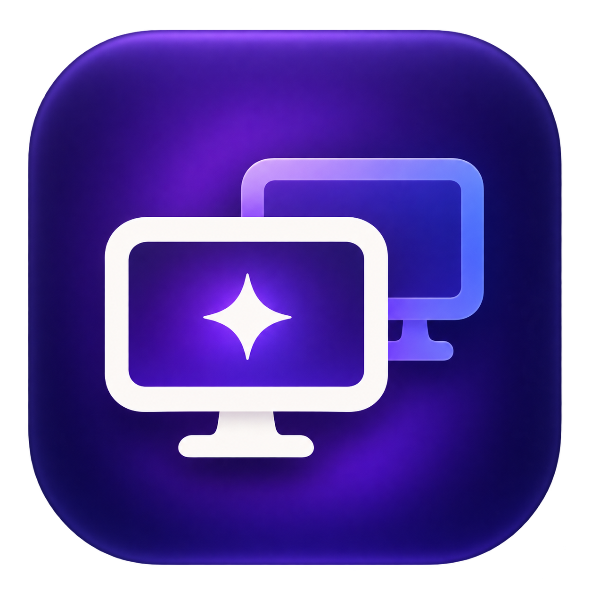

<p align="center">
  
</p>

<h1 align="center">Agent Display</h1>

<p align="center">
  <strong>Give your agent a screen of its own.</strong><br />
  A native macOS menu bar app with a virtual display, a live preview,<br />
  and one-click app movement between screens.
</p>

<p align="center">
  
  
  
</p>

<p align="center">
  <a href="#quick-start">Quick start</a> ·
  <a href="#everyday-controls">Controls</a> ·
  <a href="docs/SETUP.md">Setup & troubleshooting</a> ·
  <a href="docs/DEVELOPMENT.md">Development</a>
</p>

---

Move a browser, editor, or other app onto **Agent Display** and follow along in a floating window. Keep the preview small, enlarge it to inspect the work, or hide it while the virtual display stays connected.

The display sits to the left of your existing screens. Your main screen stays primary.

| | |
| :--- | :--- |
| **A sharp, live view** | 4K Retina rendering, native-resolution capture, and a resizable preview that stays above other apps and across Spaces. |
| **Apps in, apps out** | Send a running app to Agent Display. The return menu shows only apps with visible windows there. |
| **Control from the menu bar** | Show, hide, stop, restart, or quit. App lists refresh each time you open the menu. |
| **Everything stays on your Mac** | Frames stay in memory. No audio capture, recording, network client, or analytics. |

> **One Mac, one pointer.** Both screens share keyboard focus and the mouse. Agent Display provides an extended workspace, not an isolated computer or a separate login session.

## Quick start

Requires a signed-in Mac running **macOS 15.2+** and Apple Command Line Tools with a macOS 15.2+ SDK. If the tools are missing, run `xcode-select --install`.

```sh
git clone https://github.com/guglielmofonda/agent-virtual-display-mac.git
cd agent-virtual-display-mac
./Start.command
```

The first launch opens a short setup guide:

1. **Meet your workspace.** See how the second screen, floating preview, and menu bar controls fit together.
2. **Enable permissions.** Use **Allow Preview** to open macOS’s Screen Recording setup. Enable **Virtual Desktop**. Accessibility is optional and enables moving apps from the menu. Setup remembers your progress if macOS asks you to quit and reopen.
3. **Try the live preview.** Choose **Start Preview**, then optionally move an open app from the setup window. **Finish Setup** becomes available once a live frame arrives.

You can choose **Set Up Later** and return from **Setup & Permissions…** in the menu bar. Existing installations keep their normal launch behavior; the guide is always available from that menu.

The launcher builds the app locally. Next time, double-click **Start.command** or open **build/VirtualDesktop.app**. Finder and macOS permissions call the app **Virtual Desktop**.

**Rebuilding often?** [Configure stable signing](docs/SETUP.md#keep-permissions-across-updates) to preserve the app’s identity across updates. The launcher reuses your saved certificate.

## Everyday controls

Available from the **menu bar icon** and **Desktop Controls** in the preview’s title bar.

| Control | Behavior |
| :--- | :--- |
| **Show / Hide Preview** | Toggle the viewer. Hiding or closing it pauses capture and keeps the virtual display connected. |
| **Move App to Agent Display** | List all running desktop apps; move the selected app’s windows from physical screens. |
| **Bring App to Main Display** | List apps with visible normal windows on Agent Display; bring their workspace windows back. |
| **Stop / Start Virtual Desktop** | Disconnect or recreate the display. Stopping lets macOS relocate its windows to connected screens. |
| **Restart / Quit Virtual Desktop** | Recreate the display, or quit the app and disconnect the display it owns. |
| **Setup & Permissions…** | Reopen the setup guide, check permission status, or try moving your first app. |

**Interact through the preview:** click a point to move the real pointer there, then click again to act. Move right across Agent Display’s edge to return to the adjacent physical screen.

To move just one window, use that app’s **Window → Move to Agent Display** command when available. Exit full screen before moving. Hidden, minimized, and other-Space windows do not add apps to the return menu; apps with no movable windows show an explanatory message.

## Retina, without tiny text

Agent Display renders **3840 × 2160 pixels** in a **1920 × 1080-point workspace**. Text and windows keep their familiar size, with sharper edges. The preview captures at native resolution, up to **24 fps**.

Upgrading from the old display? If the title bar still shows 1920 × 1080, [select the Retina default and reopen the preview](docs/SETUP.md#the-upgraded-preview-still-shows-1920--1080).

## Hand it to your agent

Install the portable **Agent Display** skill for local Codex and Claude Code sessions:

```sh
python3 tools/install-skill.py --agent both
```

Then ask: **“Use the Agent Display skill to open Safari on the agent monitor.”** It can also move running apps there, bring them back, list what is on the display, and show or hide the preview.

The skill bundles a standard-library Python client that talks to the signed app locally. The app performs window movement using its existing permission. Commands return JSON results and avoid explicitly taking focus unless requested. Requires **Agent Display 0.5.0+**, Python 3.9+, and a local Mac session that can access the app’s private socket.

[Install for your agent and see examples →](docs/AGENT-SKILL.md)

Other agents can install the same [Agent Skills folder](skills/agent-display), or read its instructions and use the helper directly. A cloud-only agent cannot control the Mac through this skill. App-wide moves affect all eligible source windows; for a dedicated browser window, the skill directs the agent to use the browser’s own window tools.

For an existing Agent2Agent receiver, use the [A2A handoff example](examples/README.md).

## Permissions and compatibility

**Screen recording** permission lets the app display frames; the viewer selects only Agent Display, although macOS grants permission app-wide. **Accessibility** permission lets it inspect and move app windows.

Built with Objective-C, AppKit, CoreGraphics, and ScreenCaptureKit, with no third-party runtime dependencies. Virtual display creation uses Apple’s private `CGVirtualDisplay` API, which may change with macOS updates. The live 4K preview has been verified on Apple silicon running macOS 26.6.2.

| Need help? | Start here |
| :--- | :--- |
| Permissions, signing, blank preview, or display modes | [Setup & troubleshooting](docs/SETUP.md) |
| Build commands, tests, and code structure | [Development](docs/DEVELOPMENT.md) |
| Codex, Claude Code, and portable agent commands | [Agent skill setup](docs/AGENT-SKILL.md) |
| Reproducible bug or feature request | [GitHub Issues](https://github.com/guglielmofonda/agent-virtual-display-mac/issues) |
